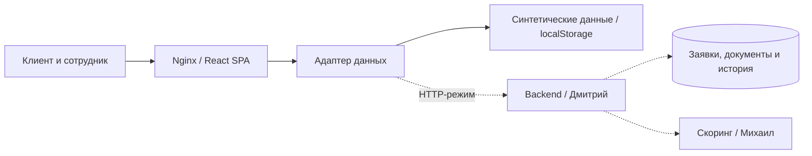

# Milk Tower — умный кредитный кабинет предпринимателя

Командный веб-прототип для кейса Альфа-Банка и Changellenge >>. Объединяет потребность бизнеса в финансировании, подачу заявки, рассмотрение сотрудником и получение результата. Предприниматель видит статус и следующее действие, сотрудник работает с теми же данными и историей.

## Команда и состояние компонентов

| Направление | Ответственный | Что находится в репозитории | Что добавляет ответственный |
|---|---|---|---|
| Frontend | Кирилл Коноплев | React-кабинеты клиента и сотрудника, демо-логика, HTTP-адаптер, тесты, Nginx и Docker-сборка | Согласование и подключение API, серверного входа и обновлений статусов |
| Backend | Дмитрий Богданов | Каталог [backend/](backend/README.md), предложение OpenAPI и контейнерный контракт | Сервер, авторизация, хранение заявок/файлов, миграции, бизнес-логика, тесты, lock-файл и Dockerfile |
| ML | Михаил Уляхин | Каталог [ml/](ml/README.md), шаблон манифеста модели и CPU/GPU-конфигурация | Скоринг, признаки, модель или правила, inference API, объяснения, метрики, зависимости и Dockerfile |

**Сейчас доступно автономное frontend-демо.** Backend и ML ещё не реализованы; Docker-интеграция для них подготовлена. Баллы и проверки в демо синтетические, решение выбирает пользователь в роли сотрудника. Подписание и выдача средств моделируются. Таблица фиксирует текущую готовность, а каталоги backend и ML оставлены для работы коллег.

## Окружение и быстрый запуск

Нужны Git, современный браузер и запущенный Docker Engine с Compose **2.20+** либо Docker Desktop с Linux-контейнерами. Целевой ПК — **4 ядра CPU и 8 ГБ ОЗУ**. Дискретная видеокарта не требуется. Для frontend-демо достаточно около 2 ГБ диска под образы и кэш сборки; требования модели позднее укажет ML-разработчик.

```bash
git clone https://github.com/Churachok/milktower_523.git
cd milktower_523
docker compose up --build -d --wait --wait-timeout 60
```

Открыть **[http://localhost:8080](http://localhost:8080)**. Compose собирает frontend и ждёт его healthcheck. Node.js, Python, база данных и внешние API на хосте для этого режима не нужны. Первая сборка требует сеть для образов и npm-пакетов; собранное демо работает автономно.

```bash
docker compose ps                    # состояние и healthcheck
docker compose logs --tail=100        # диагностика
docker compose down                  # остановить, сохранив данные браузера
docker compose up -d --wait           # запустить уже собранное демо
```

Работающий frontend ограничен 1 CPU / 128 МиБ. JavaScript heap сборки ограничен 1 ГиБ; native-компоненты и Docker расходуют память дополнительно. При Docker Desktop ориентир для демо — 2 CPU / 2 ГБ памяти виртуальной машины. Подробности и ограничения проверки: [Docker](docs/docker.md), [результаты проверки](docs/verification.md).

### Общий запуск после подключения backend и ML

Для командной интеграции подготовлен отдельный Compose-файл. Он ожидает реализацию и `backend/Dockerfile` от Дмитрия, `ml/Dockerfile` от Михаила, согласованные API и серверный вход. Сейчас это конфигурация подключения, а не готовый сквозной серверный стек.

```bash
docker compose --parallel 1 -f compose.yaml -f compose.integration.yaml up --build -d --wait --wait-timeout 180
```

В этом режиме frontend собирается с `VITE_API_MODE=http`, Nginx передаёт `/api/v1/...` в backend, а backend получает `ML_BASE_URL=http://ml:8001`. Наружу открыт только порт frontend. Предусмотрены том backend `/data`, кэш ML `/cache` и ожидание готовности ML → backend → frontend.

Плановый лимит трёх контейнеров — **3,5 CPU / 4,125 ГиБ**: frontend 0,5 CPU / 128 МиБ, backend 1 CPU / 1 ГиБ, ML 2 CPU / 3 ГиБ. Это бюджет конфигурации; подходящую модель и фактический расход памяти проверяет ML-инженер. Для NVIDIA дополнительно подготовлен `compose.gpu.yaml`; CPU остаётся базовым режимом. Условия и команда GPU-запуска — в [docs/docker.md](docs/docker.md).

## Архитектура и используемые компоненты



Сплошные связи — доступное frontend-демо; пунктир — подготовленная интеграция сервисов команды. Скоринговая рекомендация и решение по кредиту разделены. Запрос уточнения возвращает заявку на проверку; исходные условия и предложение банка сохраняются отдельно.

| Компонент | Технологии / место для дополнения |
|---|---|
| Frontend | React / React DOM **19.2.0**, JavaScript, HTML, CSS; Node.js **22.x**, Vite **8.3.5**, npm lock-файл |
| Раздача | Nginx `stable-alpine`, два Docker target: `demo` и `integration` |
| Backend | Стек, СУБД, версии, сессии и команды тестов добавляет Дмитрий в [backend/README.md](backend/README.md) |
| ML | Подход, модель/правила, версии, признаки и метрики добавляет Михаил в [ml/README.md](ml/README.md) |
| Проверки | Node.js test runner, проверка состава репозитория, HTTP smoke-проверка, GitHub Actions |

[Полная схема, модель данных и диаграмма состояний](docs/architecture.md). [OpenAPI 3.1](docs/openapi.json) и [коллекция HTTP-запросов](docs/requests.http) — предлагаемый контракт frontend/backend, который команда актуализирует при интеграции. Контракт backend/ML согласуют ответственные за эти сервисы.

## Конфигурация

| Переменная | По умолчанию | Назначение |
|---|---|---|
| `APP_PORT` | `8080` | Порт frontend на localhost, корневой `.env` |
| `VITE_API_MODE` | `mock` | Локальный Vite: `mock` или `http`; в Docker задаётся выбранным target |
| `VITE_API_BASE_URL` | `/api/v1` | Префикс API в `frontend/.env.local`; Docker использует same-origin `/api/v1` |
| `BACKEND_IMAGE` | `milk-tower-backend:local` | Тег образа backend в интеграционном Compose |
| `ML_IMAGE` | `milk-tower-ml:local` | Тег CPU-образа ML в интеграционном Compose |
| `ML_GPU_IMAGE` | `milk-tower-ml-gpu:local` | Тег дополнительного GPU-образа ML |

Без `.env` демо использует значения по умолчанию. Чтобы сменить порт, скопировать `.env.example` в `.env`. Для интеграции есть `.env.integration.example`; локальную копию передавать Compose через `--env-file .env.integration` перед `-f`. Теги backend/ML сейчас являются именами будущих локальных сборок, а не опубликованными образами.

Настройки портов, хранения и потоков сервисов описаны в [Docker-инструкции](docs/docker.md) и README соответствующих направлений. Локальные env не входят в Git и контекст Docker. Переменные `VITE_*` публичны в браузерной сборке и не предназначены для секретов.

## Пошаговый сценарий проверки демо

Демо открывается под **Александром Волковым, ООО «Мануфактура»**. Переключатель «Клиент / Сотрудник» — в шапке; сотрудник — **Елена Смирнова**. Пароль не нужен. Это две синтетические роли для проверки UI, серверные учётные записи подготовит backend-разработчик.

1. Нажать «Новая заявка», выбрать оборотные средства, **2 400 000 ₽ на 18 месяцев**, затем «Продолжить с этими условиями».
2. Оставить синтетическую компанию, указать цель «Закупка сырья». Ввести выручку **12 000 000 ₽**, расходы **7 000 000 ₽**, обязательства **0 ₽**, возраст бизнеса **3 года**.
3. Добавить [statement.pdf](docs/fixtures/statement.pdf) с типом «Выписка» и [financial-report.pdf](docs/fixtures/financial-report.pdf) с типом «Финансовая отчётность». Проверить сведения, отметить согласие и отправить. Ожидается **«На проверке»**.
4. Переключиться на сотрудника, нажать «Завершить демо-проверки», изучить вкладку «Проверки и скоринг».
5. Запросить сведения: «Уточните текущую задолженность». Клиентом ответить «Просроченная задолженность отсутствует». Заявка возвращается на проверку.
6. Сотрудником повторно завершить проверки и предложить **2 000 000 ₽ на 24 месяца под 20%**.
7. Клиентом сравнить условия, нажать «Принять предложение» и подтвердить ознакомление. Ожидается **«Средства получены»** с отметкой о моделировании выдачи.
8. Перезагрузить страницу: исходные условия, результат и история сохраняются.

Готовые примеры: `PT-2026-0042` — уточнение, `PT-2026-0038` — предложение, `PT-2026-0045` — рассмотрение и отказ с причиной, `PT-2026-0046` — черновик. Восстановление четырёх исходных заявок: профиль → «Восстановить демо-данные» → подтверждение. [Расширенные сценарии](docs/test-scenarios.md).

## Разработка и проверки

Для frontend нужен Node.js **22.12+** и npm; ветка 22 указана в `.nvmrc` и Dockerfile. Пример локальных настроек — `frontend/.env.example`.

```bash
cd frontend
npm ci
npm test
npm run build
npm run dev
```

Vite показывает адрес, обычно [http://127.0.0.1:5173](http://127.0.0.1:5173). Из корня `node scripts/check-repository.mjs` проверяет состав репозитория и правила Git, `node scripts/smoke.mjs` — HTTP работающего Docker-демо. Команды тестов backend и ML заполняют коллеги в своих каталогах. В [CI](.github/workflows/ci.yml) настроены проверки репозитория, frontend и Docker-демо, а также валидация интеграционных Compose-файлов.

## Данные, ограничения и комплект для жюри

Демо использует только синтетические данные и работает без платных API, закрытых моделей и корпоративных систем. ЕГРЮЛ/БКИ, скоринг, подписание и выдача смоделированы. Содержимое загружаемых файлов не сохраняется — только метаданные. Заявки находятся в `localStorage` одного origin, роль — в `sessionStorage`; перезапуск контейнера не очищает браузер. Другой адрес/порт/профиль создаёт отдельное хранилище. Поддержка — локальный диалог без отправки сообщений сотруднику.

| Материал | Содержание |
|---|---|
| [Соответствие кейсу](docs/case.md) | Границы MVP, задачи пользователей и покрытие требований |
| [Архитектура](docs/architecture.md) | Компоненты, состояния заявки, модель данных и интеграция |
| [OpenAPI](docs/openapi.json) · [HTTP-запросы](docs/requests.http) | Предлагаемый контракт и примеры для backend |
| [Backend](backend/README.md) · [ML](ml/README.md) | Места для реализации коллег и контейнерные контракты |
| [Docker](docs/docker.md) | Демо, командная интеграция, CPU/GPU, ресурсы и диагностика |
| [Тестовые данные](docs/fixtures/README.md) · [Сценарии](docs/test-scenarios.md) | Синтетические документы, роли и шаги проверки |
| [Результаты проверки](docs/verification.md) | Что выполнено и что ещё не проверено |
| [Подготовка к сдаче](docs/submission.md) | Состав Git-версии, фиксация commit hash и действия команды |
| [THIRD_PARTY_NOTICES](THIRD_PARTY_NOTICES) | Компоненты, лицензии, модели/сервисы и смоделированные интеграции |

В Git входят код, lock-файлы, Docker/CI, документация, лицензии и необходимые синтетические fixtures. `.gitignore` исключает зависимости, виртуальные окружения, кэши, рабочие БД, uploads, тренировочные данные, веса и локальные секреты. Для модели должны остаться версия, лицензия, контрольная сумма и воспроизводимый способ получения артефакта; это заполняет ML-инженер. Перед сдачей команда обновляет готовность компонентов, API, демо-вход, THIRD_PARTY_NOTICES и фиксирует итоговый commit hash по [инструкции](docs/submission.md).
