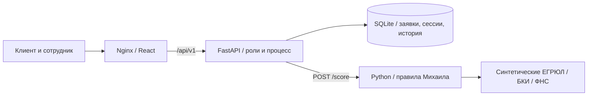

# Milk Tower — умный кредитный кабинет предпринимателя

Командный прототип для кейса Альфа-Банка и Changellenge >>: подбор финансирования, заявка предпринимателя, рассмотрение сотрудником, скоринг и результат. В `main` объединены frontend, backend и ML; обычный запуск использует серверные сессии и SQLite.

| Направление | Ответственный | Реализация |
|---|---|---|
| Frontend | Кирилл Коноплев | React 19, публичные страницы, кабинеты клиента и сотрудника, калькулятор, документы, история |
| Backend | Дмитрий Богданов | FastAPI, SQLAlchemy, SQLite, Alembic, cookie-сессии, роли, заявки, переходы и аудит |
| ML | Михаил Уляхин | Python-скоринг по правилам 1.0.1, синтетические внешние признаки, объяснения; опциональные Groq-помощники |

## Быстрый запуск

Нужны Git и работающий Docker Engine с Compose 2.20+ либо Docker Desktop. Целевой ПК — 4 CPU / 8 ГБ ОЗУ; GPU и ключи API не нужны.

```bash
git clone https://github.com/Churachok/milktower_523.git
cd milktower_523
./scripts/run.sh
```

Открыть [http://localhost:8080](http://localhost:8080), нажать «Личный кабинет», выбрать предпринимателя или сотрудника и войти. Демо-вход без пароля создаёт настоящую серверную сессию для синтетического пользователя. Для смены роли выйти через профиль и войти другой ролью. После перезагрузки сессия восстанавливается.

Compose запускает ML → backend → frontend, публикует только frontend на localhost. Заявки, история, оценки и предложения сохраняются в Docker-томе `backend-data`; обычный `docker compose down` сохраняет его. Первая сборка требует сеть; основной собранный продукт работает без внешних API. Подробности — [Docker](docs/docker.md).

```bash
docker compose ps
docker compose logs --tail=100
docker compose down
docker compose up -d --wait
```

## Версия и комплект сдачи

Текущая версия — **1.1.0**. Проверенная сдаваемая версия фиксируется тегом `submission-2026-10-26`. [Матрица требований кейса](docs/requirements.md), [комплект сдачи](docs/submission.md), [исследование и банковские практики](docs/product-research.md). Скрипт `run.sh` передаёт полный Git commit в образы; `/api/v1/version` и `/version.json` показывают одинаковый идентификатор. Для распакованного архива идентификатор берётся из `SOURCE_COMMIT`.

[Swagger UI](http://localhost:8080/api/v1/docs) и `/api/v1/openapi.json` доступны через общий адрес приложения; JS/CSS документации локальные. Основной вариант `docker compose up --build -d --wait --wait-timeout 180` также работает, но без `BUILD_COMMIT` обозначает сборку как `development`.

## Сценарий проверки

1. На странице «Кредиты» рассчитать **2 400 000 ₽ на 18 месяцев** и нажать «Продолжить с этими условиями». Войти предпринимателем; появится один черновик с выбранными условиями.
2. Проверить компанию, указать цель «Закупка сырья», выручку **12 000 000 ₽**, расходы **7 000 000 ₽**, обязательства **0 ₽**, возраст **3 года**.
3. Загрузить [statement.pdf](docs/fixtures/statement.pdf) как выписку и [financial-report.pdf](docs/fixtures/financial-report.pdf) как финансовую отчётность. Подтвердить согласие и отправить заявку.
4. Через профиль выйти, войти сотрудником, открыть заявку в очереди и нажать «Завершить проверки и скоринг». Backend вызывает ML; оценка и факторы доступны во вкладке «Проверки и скоринг».
5. Запросить «Уточните текущую задолженность». Клиентом ответить «Просроченной задолженности нет». Предыдущая оценка очищается; сотрудник выполняет повторную проверку.
6. Сотрудником предложить **2 000 000 ₽ на 24 месяца под 20%**. Клиентом принять предложение и подтвердить ознакомление. Статус — «Средства получены».
7. Открыть «Для бизнеса»: персональная лента подбирает материалы по продукту, отрасли, финансовой ситуации и статусам заявок; показывает причину выбора. Изменение последнего черновика меняет подбор. Тексты учебные, внешних новостных API нет.
8. Перезагрузить страницу: исходные условия, предложение, история и результат ML сохраняются на сервере.

Начальные примеры: `PT-2026-0042` — уточнение, `0038` — предложение, `0045` — отказ, `0046` — черновик. Другой тестовый клиент `ivanova` не видит чужие заявки; сотрудник не видит черновики. Дополнительные проверки — [сценарии](docs/test-scenarios.md).

## Архитектура



Статусы видимой вкладки обновляются каждые 10 секунд и при возврате к ней. В форме есть чек-лист документов и условный сценарий бюджета со снижением выручки на 20%.

Скоринг рекомендует действие; итоговое решение отдельно фиксирует сотрудник. Ошибка ML оставляет заявку на проверке и позволяет повторить запрос. Содержимое загружаемых файлов не сохраняется: сервер проверяет формат и размер, хранит метаданные. Подписание и выдача моделируются, реального перевода денег нет.

[Архитектура и состояния](docs/architecture.md) · [OpenAPI](docs/openapi.json) · [HTTP-примеры](docs/requests.http) · [Backend](backend/README.md) · [ML](ml/README.md).

## Локальная разработка

Нужны Node.js 22.12+, Python 3.12+ и uv. Базовые Docker-образы закреплены digest, Python — 3.12.12; Swagger UI 5.34.0 входит в npm lock-файл. Зависимости backend закреплены в `backend/uv.lock`, frontend — в `frontend/package-lock.json`. В отдельных терминалах:

```bash
# Из корня: ML без сторонних пакетов
python3 ml/server.py

# Backend
cd backend
uv sync --frozen
DATA_DIR=./data ML_BASE_URL=http://127.0.0.1:8001 uv run uvicorn app.main:app --port 8000

# Frontend, из корня
npm ci --prefix frontend
npm run dev --prefix frontend
```

Открыть [http://127.0.0.1:5173](http://127.0.0.1:5173). Vite передаёт `/api` в backend:8000 и `/ml-api` в ML:8001; cookies остаются на origin сайта. Режим по умолчанию — `http`.

```bash
npm test --prefix frontend
npm run build --prefix frontend
uv run --project backend pytest -q backend/tests
uv run --project backend ruff check backend
PYTHONPATH=ml python3 -m unittest discover -s ml/tests -v
node scripts/check-repository.mjs
node scripts/integration-smoke.mjs http://127.0.0.1:5173
# Проверка всей production-раздачи через Nginx:
node scripts/smoke.mjs http://127.0.0.1:8080
```

Smoke создаёт синтетическую заявку и проходит полный процесс до выдачи. Фактические результаты и ограничения — [verification.md](docs/verification.md).

## Режимы и настройки

| Настройка | Значение / назначение |
|---|---|
| `APP_PORT` | `8080`; изменить через корневой `.env`, образец `.env.example` |
| `VITE_API_MODE` | `http` по умолчанию; `mock` включает отдельное браузерное демо |
| `VITE_API_BASE_URL` | `/api/v1`; публичная настройка frontend |
| `ML_BASE_URL` | Backend → `http://ml:8001` в Docker; локально указать `http://127.0.0.1:8001` |
| `DATA_DIR` | Backend `/data` в Docker; локально writable-каталог для SQLite |
| `DEMO_LOGIN_ENABLED` | `true`; выключение запрещает оба способа демо-входа |
| `COOKIE_SECURE` | `false` для локального HTTP |

Браузерное демо без backend запускается отдельно: `docker compose -f compose.demo.yaml up --build -d --wait`. Оно сохраняет данные в localStorage и использует `/ml-api`. Старый `compose.integration.yaml` сохранён как совместимое дополнение; основной файл уже содержит полный стек.

Новый коммит ML включает опциональные распознавание PDF и генерацию дозапроса через Groq. Они сохранены в `ml/main.py` и доступны с `compose.ai.yaml`; требуют явного выбора режима и `GROQ_API_KEY`. Основной продукт использует локальные правила и работает без ключа. Инструкции и границы — в [ML README](ml/README.md). Ключи не передаются в frontend и не входят в Git.

## Данные и комплект

Все компании, документы и результаты синтетические. Кредитное качество правил на реальных данных не измерено. Поддержка — локальный диалог. Демо-вход предназначен для прототипа; промышленная банковская авторизация не реализована.

[Соответствие кейсу](docs/case.md), [THIRD_PARTY_NOTICES](THIRD_PARTY_NOTICES), [подготовка к сдаче](docs/submission.md), [тестовые документы](docs/fixtures/README.md). В Git входят исходники, lock-файлы, миграции, fixtures, Docker/CI и документация. Секреты, виртуальные окружения, рабочая БД и кэши исключены.
