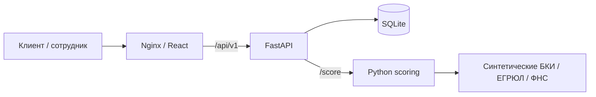
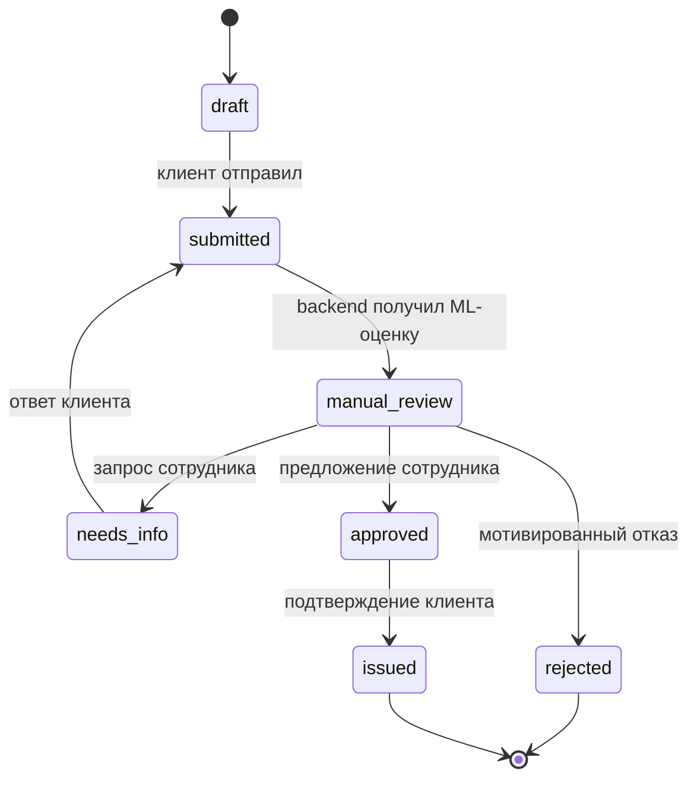

# Архитектура Milk Tower

## Компоненты

Основной продукт — React SPA, backend FastAPI/SQLite и отдельный Python-скоринг Михаила. `compose.yaml` поднимает все три сервиса. Frontend получает заявки через HTTP, backend проверяет сессии, роли и переходы, хранит данные и вызывает ML.

| Направление | Ответственный | Код |
|---|---|---|
| Frontend | Кирилл Коноплев | `frontend/src`, HTTP-адаптер, Nginx |
| Backend | Дмитрий Богданов | `backend/app`, Alembic, сессии, хранение, аудит |
| ML | Михаил Уляхин | `ml/server.py`, `demo.py`, `domain`, fixtures; опциональный `main.py` |

## Вход и доступ

Публичные страницы `/`, `/products`, `/how-it-works`, `/login` не требуют входа. Выбор роли на странице входа отправляет `POST /api/v1/session` с синтетическим логином `volkov` или `smirnova`. Сервер выдаёт HttpOnly cookie; в БД хранится хэш токена. Сессия действует 12 часов, восстанавливается через `GET /session`, завершается через `DELETE /session`. Демо-вход отключается настройкой `DEMO_LOGIN_ENABLED=false`.

Клиент видит только свои заявки; сотрудник видит отправленные заявки всех клиентов. Сотрудник не меняет черновики и не подтверждает выдачу вместо клиента. Сервер возвращает 401 без сессии, 403 для чужой роли, 404 для скрытой заявки, 409 для недопустимого перехода. Другой синтетический клиент `ivanova` используется для проверки изоляции.

Калькулятор сохраняет ожидаемые условия в `sessionStorage`; черновик создаётся после входа клиента. В HTTP-режиме заявки в localStorage не записываются. Смена роли выполняется выходом и новым входом.

## Процесс

ML получает годовые выручку/расходы, остаток долга, возраст бизнеса, ИНН, условия кредита и типы документов. Контакты и файлы ML не отправляются. Он возвращает балл 0–1000, факторы, синтетические внешние проверки, рекомендацию, признаки и допущения. Backend сохраняет ответ в `scoring_result`, проверенные итоги — в `checks`, рекомендации — отдельно от решения сотрудника. Ошибка или некорректный ответ ML оставляет прежние статус и историю; автоматической подмены оценки нет.

Ответ на дозапрос очищает старые `checks` и `scoringResult`; требуется новая проверка. Смена статуса использует условный UPDATE, повторное действие получает 409. История и аудит фиксируются в той же транзакции. Предложение хранится отдельно от исходных суммы, срока и расчёта.

## Хранение и контракт

SQLite находится в `$DATA_DIR/app.db`, в Docker — в томе `backend-data`. Alembic обновляет схему при старте; синтетический seed создаётся в пустой БД. Миграция `0002` добавляет сохранение ML-ответа в существующие БД.

Application включает компанию, финансы, условия, документы, историю, сообщения, checks/scoringResult, предложение и причину отказа. Формат — [OpenAPI](openapi.json). Даты ISO 8601 UTC, интерфейс отображает Asia/Novosibirsk. Сервер пересчитывает аннуитет, проверяет лимиты продуктов и обязательные данные перед отправкой.

Загрузка принимает PDF/JPG/PNG до 10 МиБ и проверяет сигнатуру; хранятся только метаданные. Распознавание PDF через внешний Groq существует как отдельный опциональный endpoint ML, не используется при обычной загрузке. Подписание и перевод средств моделируются. Поддержка остаётся локальным диалогом.

## Дополнительные режимы

`compose.demo.yaml` — явное браузерное демо с localStorage и прямым `/ml-api`; основной запуск его не использует. `compose.ai.yaml` включает FastAPI-вариант ML с совместимым `/score` и опциональными Groq endpoints. Без ключа основной скоринг продолжает работать; вызов AI-помощника получает 503.

Nginx и Vite сохраняют origin браузера при проксировании `/api`. HTTP-таймаут frontend — 15 секунд, ML-запрос backend — 5 секунд. Статусы обновляются при загрузке страницы, ручном обновлении и собственных действиях; push-обновлений между разными браузерами нет. Шрифты и графика локальные.

[Docker](docker.md) · [Backend](../backend/README.md) · [ML](../ml/README.md) · [Проверки](verification.md).
