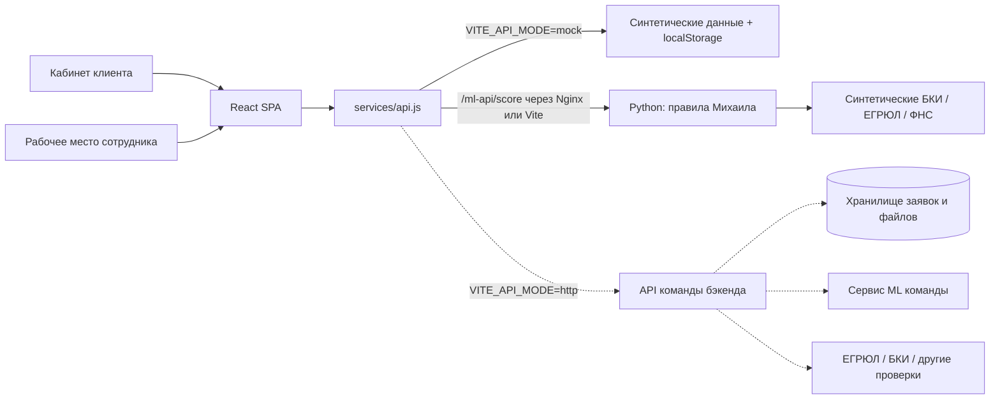
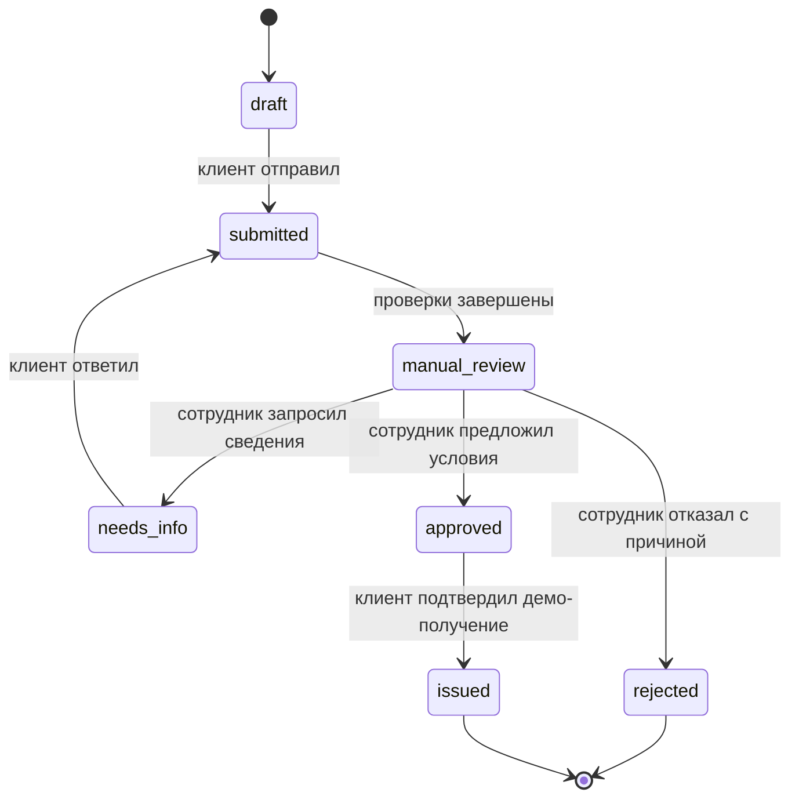

# Архитектура Milk Tower

## Границы ответственности

Frontend-часть реализована как React SPA: клиентский кабинет, формы, документы, статусы, результат и рабочее место кредитного специалиста. Демо-адаптер сохраняет данные в браузере. Правила Михаила выполняются отдельным stateless Python-сервисом без базы и авторизации; полноценный backend остаётся в зоне Дмитрия.

| Направление | Ответственный | Область |
|---|---|---|
| Frontend | Кирилл Коноплев | UI, клиентская валидация, HTTP-адаптер и Nginx |
| [Backend](../backend/README.md) | Дмитрий Богданов | Сессии, серверные правила, данные, документы, API и взаимодействие с ML |
| [ML](../ml/README.md) | Михаил Уляхин | Признаки, модель/правила, inference, объяснения, метрики и артефакты |

## Код

- `frontend/src/App.jsx` — оболочка, hash-маршрутизация, демо-роли, загрузка данных, уведомления.
- `pages/` — обзор, продукты, форма, карточка, документы, очередь сотрудника, демо-диалог.
- `components/` — доступные элементы интерфейса, таблица, история, модальные окна.
- `domain/application.js` — подписи статусов, допустимые действия UI, проверка полей и предварительный аннуитетный расчёт. Это ограничения прототипа, не банковский кредитный движок.
- `services/api.js` — единая точка работы с данными. Режимы mock и HTTP выбираются при сборке.
- `data/seed.js` — четыре синтетические заявки и демонстрационные ответы проверок. Баллы не вычисляются и не являются ML-прогнозом.
- `services/scoring.js` → `ml/server.py` → `ml/demo.py` → `ml/domain/` — вычисляемая оценка новых проверок, преобразование годовых финансов в признаки и объяснение результата. Ошибка сервиса сохраняет прежний статус; подмены результатом-константой нет.

## Состояния заявки

Скоринговая рекомендация отображается отдельно от решения. Сотрудник может предложить сумму меньше запрошенной и другой срок. Терминальные статусы не открываются повторно. Ответ на уточнение возвращает заявку на проверку и очищает предыдущие `checks` и `scoringResult` до нового расчёта.

## Модель данных

`Application`: id, productId, status, amount (рубли), term (месяцы), purpose, company, finances, documents[], consent, history[], messages[], calculation?, checks?, request?, offer?, rejectionReason?, createdAt, updatedAt.

`Company`: name, inn (строка из 10 или 12 цифр), industry, contact, email, phone.

`Finances`: revenue и expenses за 12 месяцев; debt — остаток обязательств; years — возраст бизнеса.

`Document`: id, name, size (байты), kind (`statement`, `report`, `additional`, `other`), uploadedAt, demo. В mock содержимое файлов не хранится, сохраняются только метаданные.

`HistoryEvent`: id, title, detail, actor, at (ISO 8601 UTC). Интерфейс выводит время в Asia/Novosibirsk.

`Offer`: amount, term, rate (% годовых), expiresAt. `Checks`: score, rating, recommendation, factors[{code, delta, label, positive}], source?, modelVersion?, externalChecks?. `scoringResult` сохраняет рекомендации кредитной логики, признаки и допущения; не меняет статус автоматически. Рабочий ML API описан в [scoring-openapi.json](scoring-openapi.json).

`LoanCalculation`: amount, term, rate, monthlyPayment, totalPayment, overpayment — предварительный расчёт по минимальной ставке продукта. Калькулятор не создаёт заявку до нажатия «Продолжить с этими условиями». `POST /applications` получает выбранные amount/term и снимок calculation; при редактировании условий черновика снимок пересчитывается. После отправки первоначальные amount/term/calculation сохраняются отдельно от offer. Снимок — данные интерфейса, серверу нужно валидировать или пересчитывать их. Для старых заявок без снимка UI явно помечает расчёт по текущей минимальной ставке.

`domain/navigation.js` сохраняет открытый номер заявки при переключении демо-ролей. Черновик сотруднику не открывается. Компонент карточки перемонтируется при смене роли, чтобы закрыть диалоги действий и сбросить вкладку проверок.

## Интеграция

Предложенный интерфейс описан в `openapi.json`, примеры запросов — в `requests.http`. Это контракт для обсуждения с командой, сервер не включён. Сначала согласуйте формат ролей, единицы финансовых данных, коды состояний и версионирование.

1. Реализовать endpoints в бэкенде и возвращать Application в указанном формате.
2. Для Vite сменить `VITE_API_MODE=http` и `VITE_API_BASE_URL` в `.env.local`, пересобрать frontend. В Docker это уже делает target `integration`; Nginx передаёт `/api/v1/...` в `backend:8000`, сохраняя origin и путь.
3. Реализовать `GET /session` → `{role: "client" | "employee"}` для подключения существующей серверной сессии к UI входа и `DELETE /session` для её завершения. Текущий вход и переключение ролей — демонстрационные. В HTTP режиме сервер обязан отклонять запросы без сессии.
4. Подключить загрузку/скачивание реальных документов, авторизацию, CSRF, проверку ролей, антивирус, квоты, идемпотентность и обработку конфликтов версий на сервере.
5. Подключить обновления статусов (polling/SSE/WebSocket) после выбора командой транспорта. Сейчас HTTP список обновляется при открытии и после действий UI.

Все `VITE_*` параметры публичны в сборке. Секреты в них хранить нельзя. Для same-origin раздачи настройте `/api/v1` на стороне общего reverse proxy. При отдельном origin нужен CORS с credentials от бэкенда. Таймаут HTTP — 15 секунд, ошибки выводятся с повторной загрузкой.

## Хранение демо

Заявки сохраняются в `localStorage` (`potok.applications.v1`), выбранная роль — в `sessionStorage`. Изменения синхронизируются между вкладками одного origin. При недоступном хранилище интерфейс сообщает, что данные останутся только в памяти. Демо не предназначено для реальных персональных или банковских данных. Начальные образцы восстанавливаются через профиль с подтверждением.

Шрифты и графика поставляются локально, для работы собранного демо интернет не нужен. Сборка воспроизводится через `npm ci` и lock-файл.

## Docker

`compose.yaml` запускает frontend и Python ML. `frontend/Dockerfile` собирает SPA в Node.js 22 и помещает `dist` в непривилегированный Nginx. Target `demo` использует mock-хранилище, proxy `/ml-api/` на `ml:8001` и JSON 503 для будущего backend API; target `integration` использует HTTP-адаптер и proxy `/api/` на backend. Обе сборки исключают локальные env. Healthchecks проверяют `index.html` и готовность ML.

`compose.integration.yaml` добавляет будущий backend, внутренние порты 8000/8001, зависимости по healthcheck и тома `/data`, `/cache`. Backend Dockerfile и реализацию добавляет Дмитрий. Общий резервный CPU-бюджет — 3,5 ядра / 4,125 ГиБ; текущий ML не требует весов, GPU или кэша. `compose.gpu.yaml` сохранён как дополнительная конфигурация для будущего `ml/Dockerfile.gpu`, с текущими правилами не используется.

Секреты, runtime-данные, датасеты и веса исключены из Git. При этом исходники, миграции, синтетические fixtures, lock-файлы и манифесты воспроизводимости должны входить в поставку. Детали: [docker.md](docker.md), [submission.md](submission.md).

## Визуальная тема Milk Tower

`src/styles.css` содержит базовые компоненты и адаптивную сетку. `src/banking.css` задаёт актуальную банковскую тему обеих ролей. Логотип хранится в `public/brand/milk-tower.svg` и используется также как favicon. Внутренние ключи `potok.*` сохранены ради совместимости с уже созданными демо-заявками.
